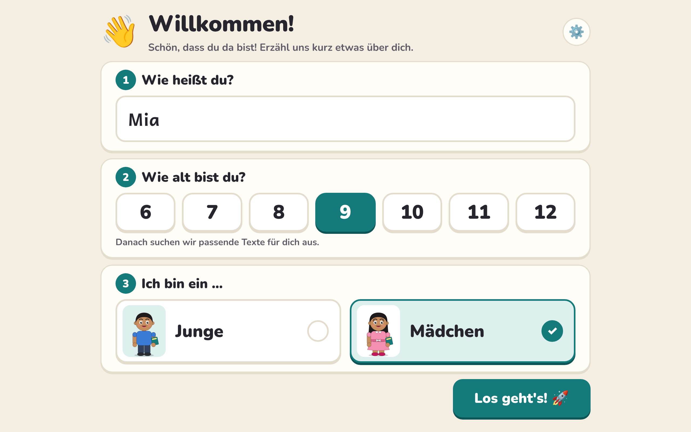
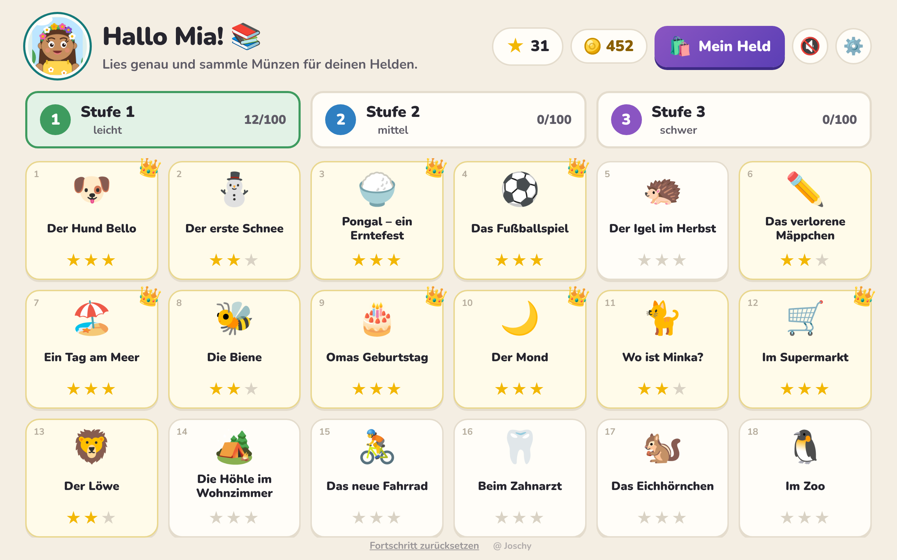
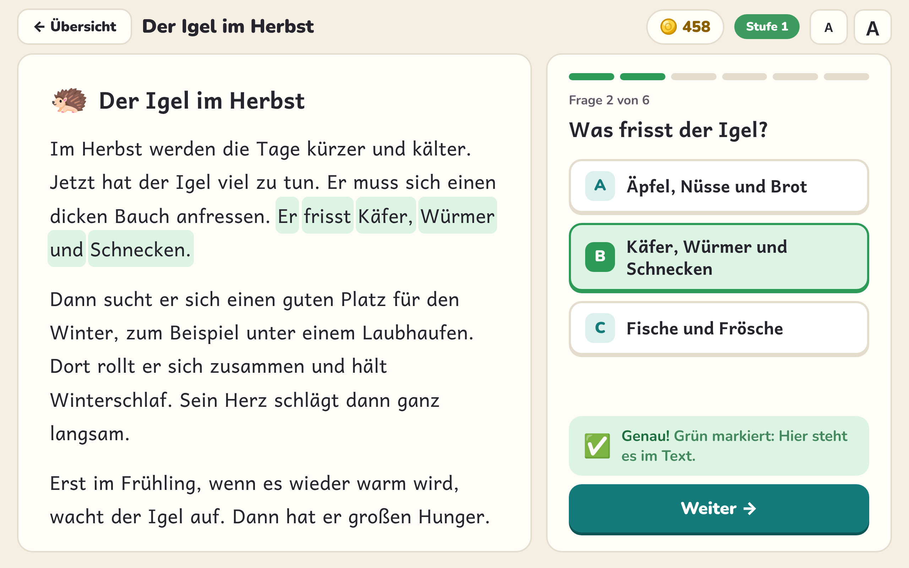
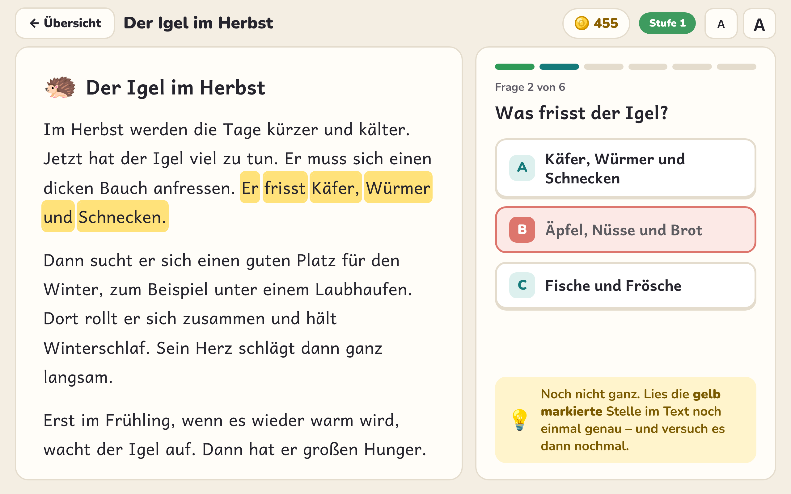
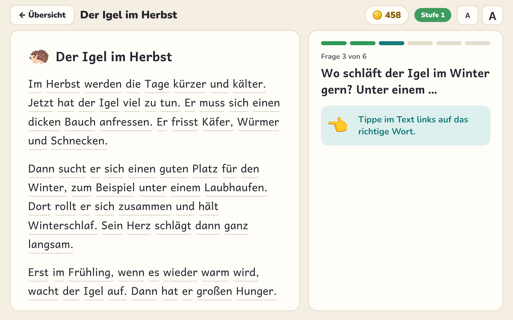
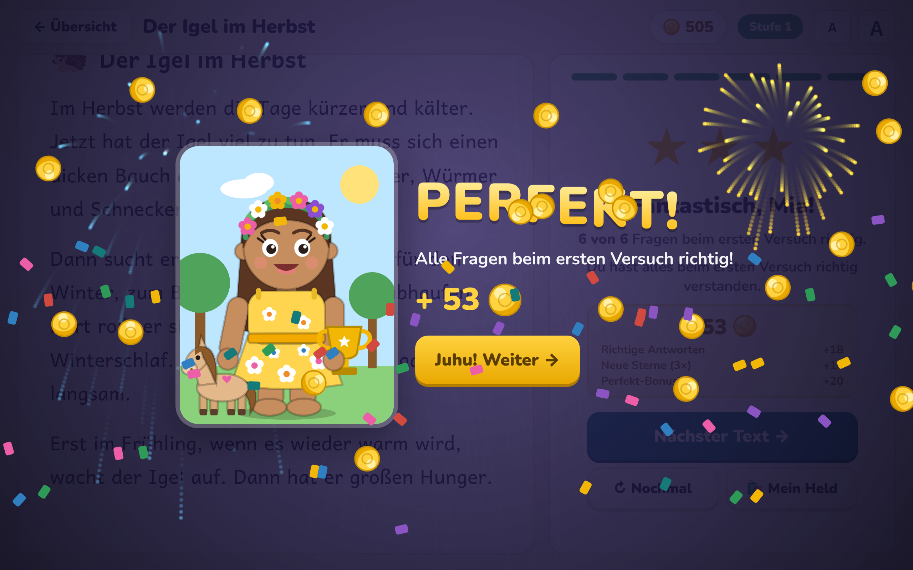
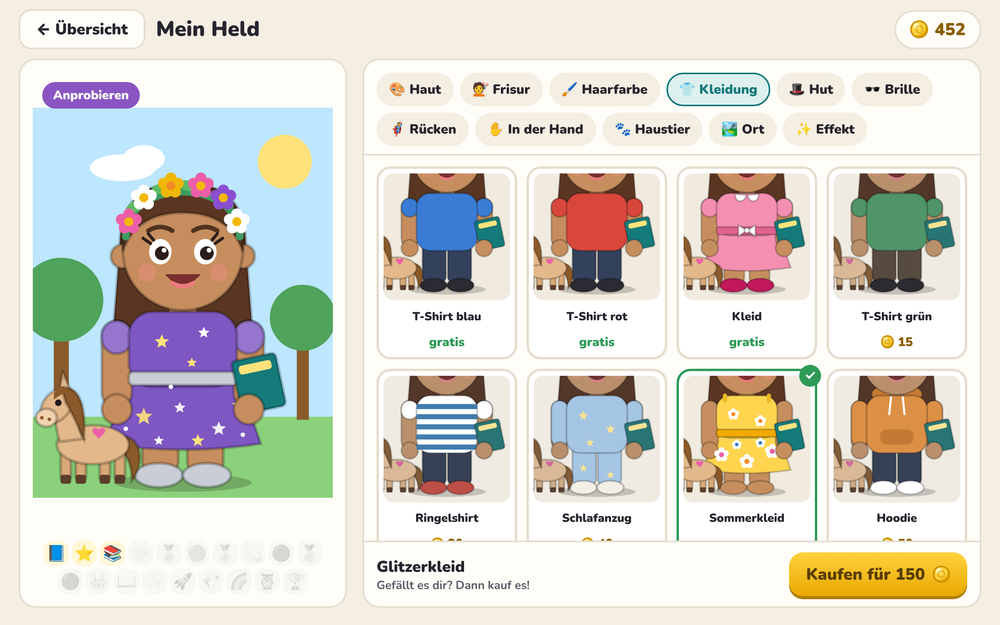
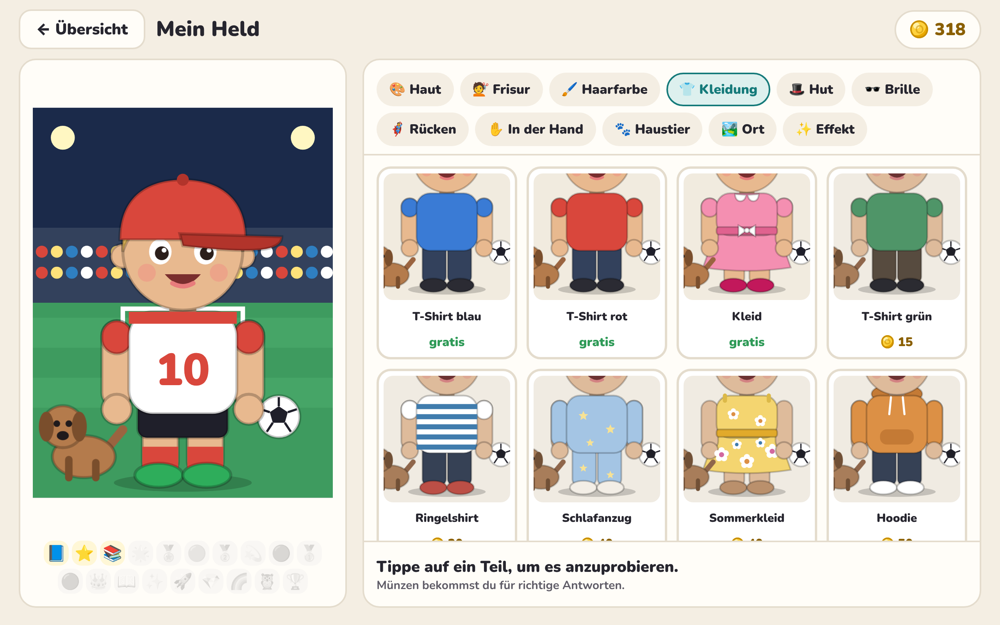
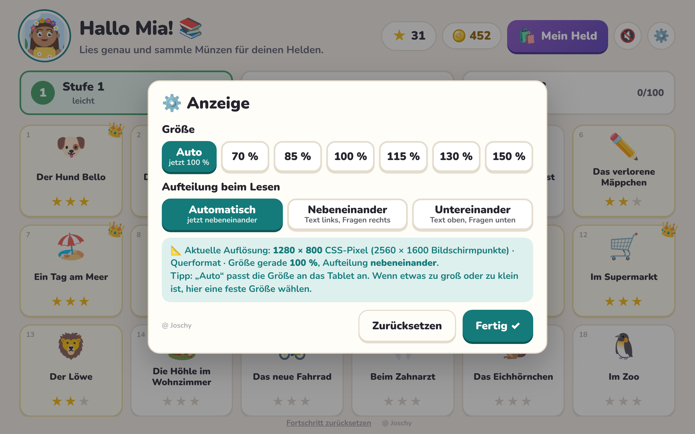
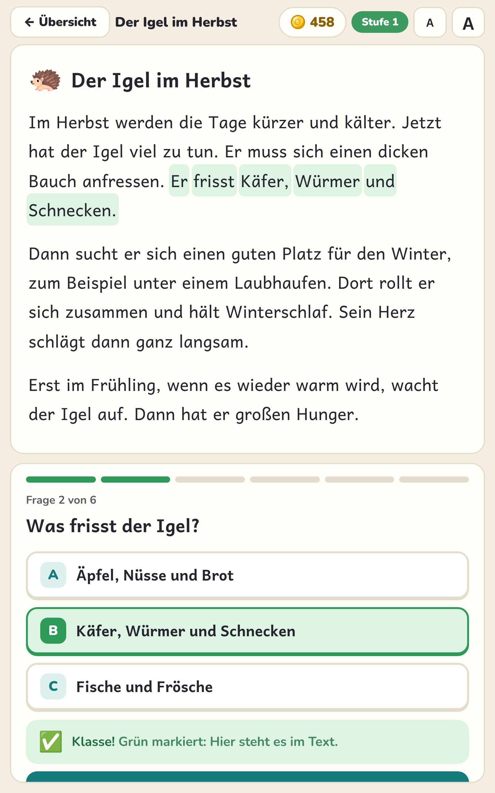

# Lesen & Verstehen

Lese-App für Vishva und andere Kinder der 4. Klasse (Android, Web-App in einer WebView). Im Querformat steht links der Text und rechts die Fragen dazu, im Hochformat steht der Text oben und die Fragen darunter.

- **Neu in 5.0:** läuft auf **anderen Tablets** und in **Hoch- und Querformat**; Einstellung **„Anzeige“** (⚙️) für Größe und Aufteilung, siehe unten
- **300 Texte, 1940 Fragen** in **3 Stufen** (je 100 Texte) – alle Texte selbst geschrieben
- **Profil beim ersten Start:** Name, Alter und **Junge oder Mädchen** auswählen; die Start-Stufe richtet sich nach dem Alter (bis 10 → Stufe 1, 11–12 → Stufe 2). Profil ändern: auf die Überschrift „Hallo …!“ tippen
- **Eigene Mädchen-Figur** (neu in 4.0): Standard mit langen Haaren und rosa Kleid; Jungen starten mit der bisherigen Figur
- **Münzen** für richtige Antworten, **Held-Shop** mit **115 Teilen** (davon 100 zum Kaufen) zum Gestalten der eigenen Figur – alle Teile sind für alle Kinder kaufbar
- **Neu in 4.1:** „Lange Haare“ ist für alle Kinder gratis; kostenlose Teile (auch die Standardteile von Junge/Mädchen, z. B. das rosa „Kleid“) stehen im Shop als „gratis“, nur mit Münzen gekaufte Teile als „gekauft“
- **Neue Shop-Teile in 4.0:** Kleider (Sommerkleid, Jeansrock, Glitzerkleid, Prinzessinnenkleid), Ballerina-Tutu, Sari, Haarschmuck (Haarschleife, Haarreif, Katzenohren, Blumenkranz), Diadem, Handtasche, Blumenstrauß, Pony und neue Frisuren (Pferdeschwanz, Zwei Dutts, Lange Locken)
- **19 Pokale** (neu u. a. für 100/150/200/250 gelesene und 100/200 perfekte Texte) und **Feuerwerk** bei einem perfekten Durchgang

## Screenshots

| | |
|---|---|
| <br>Willkommen-Screen beim ersten Start – Name, Alter, Junge oder Mädchen | <br>Startseite mit Stufen, Text-Kacheln und Sternen |
| <br>Richtige Antwort – die Textstelle wird grün markiert | <br>Falsche Antwort – gelbe Hilfe-Markierung im Text |
| <br>Fragetyp „Wort im Text antippen“ | <br>Feuerwerk und tanzende Heldin bei einem perfekten Text |
| <br>„Mein Held“ – ein Kleid anprobieren und kaufen, darunter die Pokale | <br>Held eines Jungen mit Fußballtrikot, Cap und Hund |
| <br>Neu in 5.0: Einstellung „Anzeige“ mit Größe, Aufteilung und aktueller Auflösung | <br>Neu in 5.0: Hochformat – Text oben, Fragen unten |

## Eckdaten

| | |
|---|---|
| Zielgerät | Samsung Galaxy Tab S5e (Hoch- und Querformat), andere Android-Tablets ab Android 5 |
| Paketname | `de.vishwa.lesen` (technische Kennung, bewusst unverändert, damit Updates den Spielstand behalten) |
| Version | 5.0 (versionCode 6) |

## Andere Tablets / Anzeige-Einstellungen

Die App war ursprünglich für das Galaxy Tab S5e im Querformat gebaut (1280 × 800 CSS-Pixel). Ab Version 5.0 passt sie sich an andere Bildschirme an:

- **Beide Ausrichtungen:** Das Tablet kann gedreht werden; die App startet dabei nicht neu, der Fortschritt im Text bleibt erhalten.
- **Einstellung „Anzeige“:** über das Zahnrad ⚙️ oben rechts auf der Startseite und im Profil-Bildschirm.
  - **Größe:** *Auto* (Standard) oder fest 70 %, 85 %, 100 %, 115 %, 130 %, 150 %. Es wächst alles mit – Text, Knöpfe, Figur. *Auto* rechnet die Größe aus dem Fenster aus (Grundmaß 1280 × 800 quer bzw. 800 × 1280 hochkant, begrenzt auf 70–150 %); auf dem Tab S5e ergibt das 100 % wie bisher.
  - **Aufteilung beim Lesen:** *Automatisch* (Querformat → nebeneinander, Hochformat → untereinander), *Nebeneinander* (Text links, Fragen rechts) oder *Untereinander* (Text oben, Fragen unten). Auch „Mein Held“ und das Feuerwerk ordnen sich im Hochformat untereinander an.
  - Der Dialog zeigt die **aktuelle Auflösung** (Breite × Höhe in CSS-Pixeln und Bildschirmpunkten) als Hilfe; **„Zurücksetzen“** stellt wieder Auto/Automatisch ein.
- Die Einstellung wird im Spielstand gespeichert (Feld `display: { scale, layout }`) und wirkt sofort.
- Getestet mit 2560 × 1600, 1920 × 1200, 1280 × 800, 960 × 600 (quer) sowie 1200 × 1920, 800 × 1280 und 600 × 960 (hochkant) in allen Größenstufen.

## Installation

APK aus `apk/` aufs Tablet kopieren und installieren (Installation aus unbekannten Quellen erlauben).
Aktuelle (und einzige) Version: `apk/Lesen-und-Verstehen-v5.0.apk`. Sie lässt sich direkt über Version 4.1 installieren – der Spielstand bleibt erhalten.

**Wichtig:** Updates lassen sich nur über eine installierte Version spielen, wenn sie mit **demselben Signaturschlüssel** signiert sind. Der Schlüssel liegt bewusst **nicht** im Repo.

Der Fortschritt (Profil, Münzen, Pokale, Figur) liegt im `localStorage` auf dem Tablet unter dem Schlüssel `vishwa-lesen-v1` (technische Kennung, bewusst unverändert). Deinstallieren löscht ihn, ein Update mit gleichem Schlüssel behält ihn.

## Aufbau

- `app/` – Web-App (index.html, Texte in content*.js, Figur/Shop in avatar.js, Schriften)
- `android/` – Apktool-Projekt (Manifest, smali, res)
- `apk/` – fertige APK (v5.0)
- `build.sh` – Build-Skript

## Selbst bauen

Voraussetzungen: Java (inkl. `jarsigner`), [Apktool](https://apktool.org) 2.11.1, der Keystore.

```bash
export APKTOOL=/pfad/zu/apktool.jar
export KEYSTORE=/pfad/zu/lesen.keystore
export STOREPASS='…'
./build.sh
```

Optional `export AAPT2=/pfad/zu/aapt2`, falls Apktool ein bestimmtes aapt2 nutzen soll.

Das Skript kopiert `app/` nach `android/assets`, baut mit Apktool, signiert mit dem Alias `lesen` und legt die APK als `apk/Lesen-und-Verstehen-v<Version>.apk` ab (Version aus `android/apktool.yml`).

---
@ Joschy
