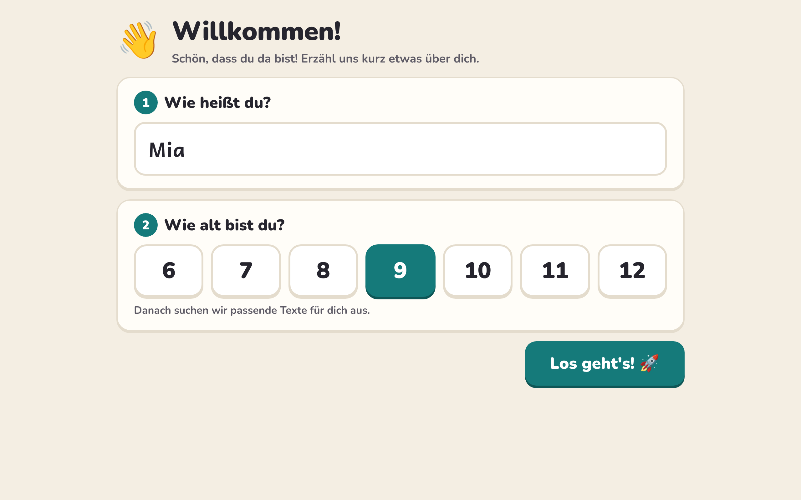
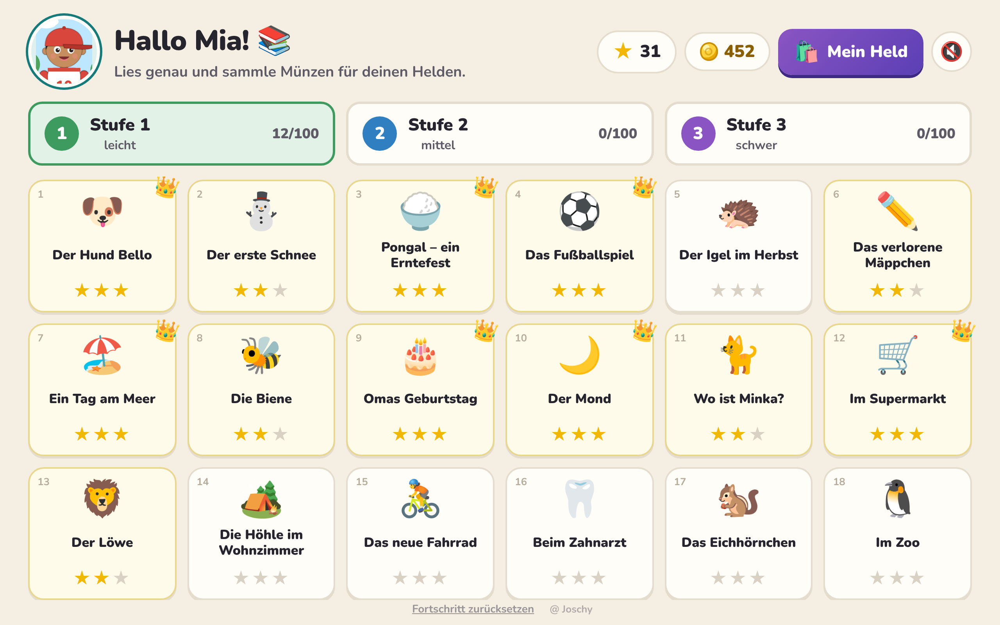
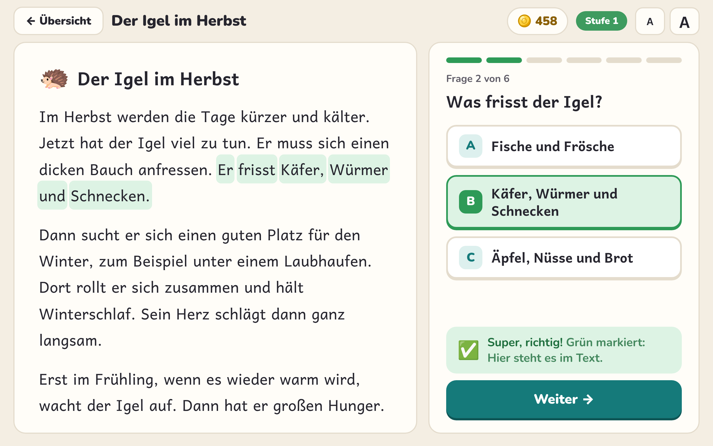
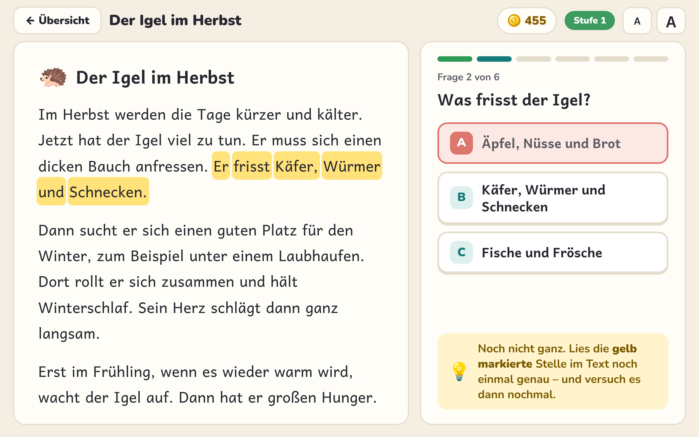
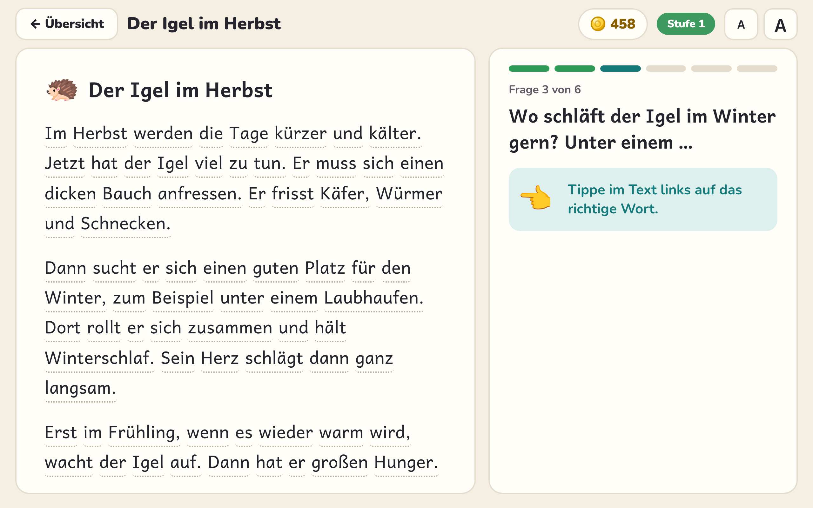
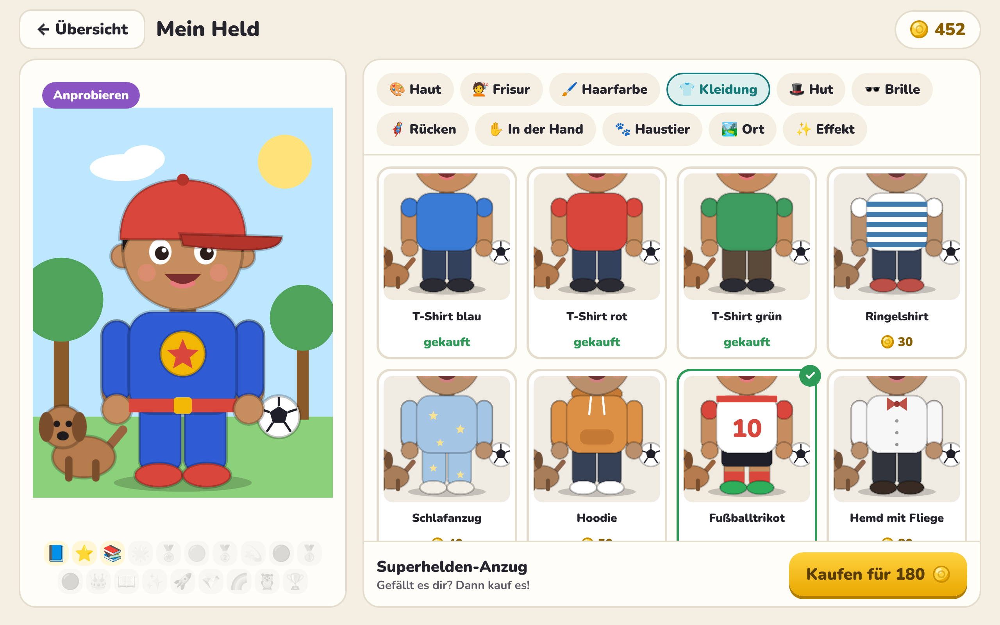

# Lesen & Verstehen

Lese-App für die 4. Klasse (Android, Web-App in einer WebView). Links steht der Text, rechts die Fragen dazu.

- **300 Texte, 1940 Fragen** in **3 Stufen** (je 100 Texte) – alle Texte selbst geschrieben
- **Profil beim ersten Start:** Name und Alter eingeben; die Start-Stufe richtet sich nach dem Alter (bis 10 → Stufe 1, 11–12 → Stufe 2). Profil ändern: auf die Überschrift „Hallo …!“ tippen
- **Münzen** für richtige Antworten, **Held-Shop** mit 84 Teilen zum Gestalten der eigenen Figur
- **19 Pokale** (neu u. a. für 100/150/200/250 gelesene und 100/200 perfekte Texte) und **Feuerwerk** bei einem perfekten Durchgang

## Screenshots

| | |
|---|---|
| <br>Willkommen-Screen beim ersten Start – Name und Alter | <br>Startseite mit Stufen, Text-Kacheln und Sternen |
| <br>Richtige Antwort – die Textstelle wird grün markiert | <br>Falsche Antwort – gelbe Hilfe-Markierung im Text |
| <br>Fragetyp „Wort im Text antippen“ | <br>Feuerwerk und tanzender Held bei einem perfekten Text |
| <br>„Mein Held“ – Kleidung anprobieren und kaufen, darunter die Pokale | |

## Eckdaten

| | |
|---|---|
| Zielgerät | Samsung Galaxy Tab S5e, Querformat |
| Paketname | `de.vishwa.lesen` |
| Version | 3.0 (versionCode 3) |

## Installation

APK aus `apk/` aufs Tablet kopieren und installieren (Installation aus unbekannten Quellen erlauben).
`Lesen-und-Verstehen-v3.apk` ist die aktuelle Version, `Lesen-und-Verstehen-v2.apk` und `Lesen-und-Verstehen.apk` sind ältere Stände.

**Wichtig:** Updates lassen sich nur über eine installierte Version spielen, wenn sie mit **demselben Signaturschlüssel** signiert sind. Der Schlüssel liegt bewusst **nicht** im Repo.

Der Fortschritt (Profil, Münzen, Pokale, Figur) liegt im `localStorage` auf dem Tablet unter dem Schlüssel `vishwa-lesen-v1`. Deinstallieren löscht ihn, ein Update mit gleichem Schlüssel behält ihn.

## Aufbau

- `app/` – Web-App (index.html, Texte in content*.js, Figur/Shop in avatar.js, Schriften)
- `android/` – Apktool-Projekt (Manifest, smali, res)
- `apk/` – fertige APKs
- `build.sh` – Build-Skript

## Selbst bauen

Voraussetzungen: Java (inkl. `jarsigner`), [Apktool](https://apktool.org) 2.11.1, der Keystore.

```bash
export APKTOOL=/pfad/zu/apktool.jar
export KEYSTORE=/pfad/zu/lesen.keystore
export STOREPASS='…'
./build.sh
```

Das Skript kopiert `app/` nach `android/assets`, baut mit Apktool und signiert mit dem Alias `lesen`.

---
@ Joschy
